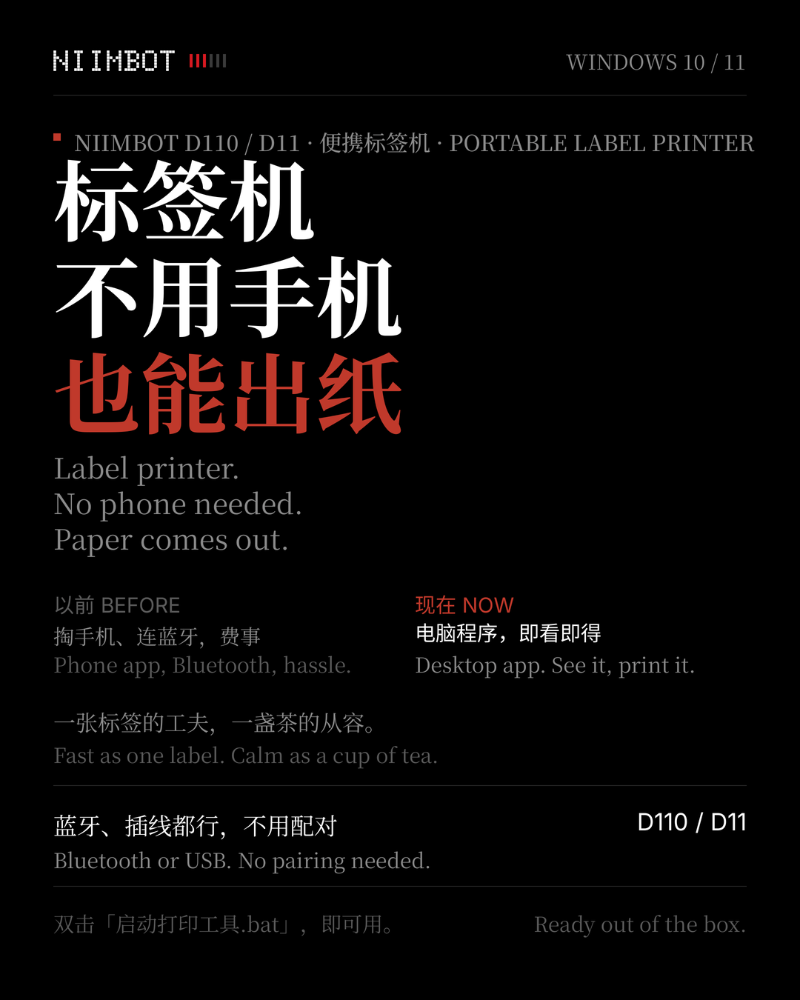
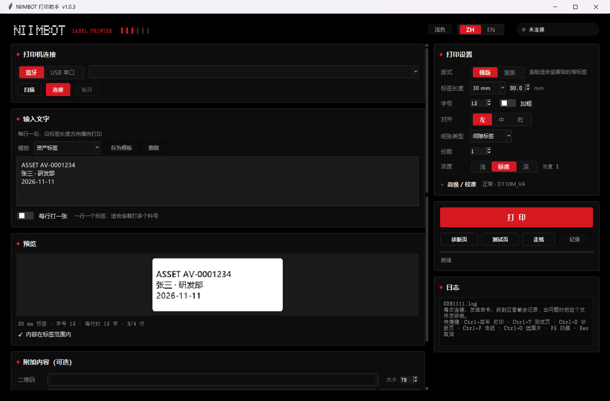
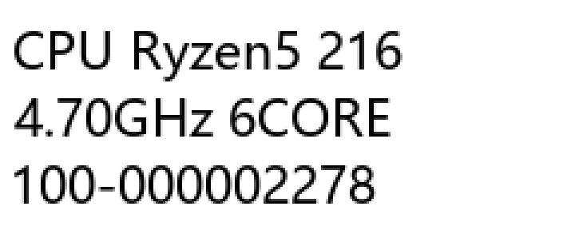
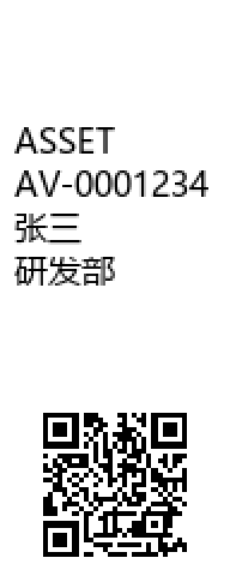

# NIIMBOT Label Printer

[简体中文](README.md) | **English**

A Windows desktop app for NIIMBOT portable thermal label printers (**D110 / D11 / B1** series).
Both the Bluetooth LE and USB serial protocols are implemented from scratch — no official
mobile app, no official SDK.



## Download (no Python required)

**[NIIMBOT-Printer-v1.0.5.zip](https://github.com/CelinaYun/niimbot-printer/releases/download/v1.0.5/NIIMBOT-Printer-v1.0.5.zip)** · 19.9 MB

Unzip the **whole folder** and run `NIIMBOT打印助手.exe`. Windows 10 / 11 64-bit, nothing to install.
(The exe needs the `_internal` directory sitting next to it — don't pull the exe out on its own.)

## Screenshots



Same 12×30 mm label stock, two layouts:

| Landscape | Portrait |
| :---: | :---: |
|  |  |
| One long line — good for part numbers | Wraps across the 12 mm width, extras below |

Landscape uses the paper sideways: 240 dots is enough for a single long line. Portrait turns
the paper 90°, so the same label fits 7–8 short lines with the QR code, barcode or image
sitting underneath the text.

## Why this exists

NIIMBOT's official app is phone-only. Printing from a PC means: screenshot → send to phone →
paste into the app → print. A dozen labels a day is a dozen round trips.

This tool skips the round trip: plug in USB or pair over Bluetooth, type, hit print.

## Features

| | |
| --- | --- |
| **Connection** | USB serial or Bluetooth LE; reconnects the last device; picks the print routine from the model ID |
| **Device discovery** | Hides earbuds, watches and other irrelevant devices; likely printers are marked ★ and sorted first |
| **Layout** | Landscape (writes along the strip) or portrait (wraps across the width); auto-shrinking font; `---` / `===` draw divider rules |
| **Extras** | QR code, barcode (Code128 / EAN-13 / UPC-A / Code39), image |
| **Batch** | One label per line, prints them in sequence |
| **Convenience** | 9 built-in templates plus your own; print history; `{date}` placeholder |
| **Troubleshooting** | Test label, diagnostic label (verifies the print head), paper feed, full protocol log |
| **UI** | Chinese / English, dark / light theme, emoji and symbols |

## Running from source

Windows 10/11 64-bit and Python 3.10+.

```bash
# One-click script — creates a venv and installs dependencies on first run
双击 nimbot-printer/启动打印工具.bat

# Or manually
cd nimbot-printer
pip install -r requirements.txt
python main.py
```

## Fonts

The UI uses Nothing's official typefaces (NDot 55 / NType 82 / NType 82 Mono). The `.otf`
files **are included in this repository**, so a fresh clone shows the full interface.

**Copyright belongs to Nothing Technology Limited.** They are bundled solely for this app's
interface — please don't extract them, reuse them in other projects, or redistribute the font
files themselves. See [`assets/fonts/NOTICE.md`](nimbot-printer/assets/fonts/NOTICE.md).

If the fonts are missing the app degrades gracefully: it falls back to `Consolas` /
`Microsoft YaHei`, so deleting the whole font directory won't break anything.

## Building the exe

```bash
cd nimbot-printer
pip install pyinstaller
python -m PyInstaller --noconfirm --clean --onedir --windowed \
    --name "NIIMBOT打印助手" --add-data "assets;assets" \
    --collect-all bleak main.py
python pack_release.py     # zips the output for distribution
```

`--onedir` rather than `--onefile`: a single-file build unpacks on every launch and took 45 s
in testing, versus 1.7 s for the directory build.

## Layout

```
nimbot-printer/          repo root
├── README.md            Chinese readme
├── README.en.md         this file
└── nimbot-printer/      application source
    ├── main.py          entry point (single-instance mutex)
    ├── gui.py           UI wiring
    ├── fluent.py        custom-drawn widgets and theming
    ├── render.py        label layout (landscape / portrait)
    ├── i18n.py          Chinese and English strings
    ├── fonts.py         registers bundled fonts for this process only
    ├── settings.py      config read/write
    ├── paths.py         data directory resolution
    ├── version.py       version number
    ├── niimbot/         protocol implementation
    │   ├── transport.py   serial / BLE
    │   ├── packet.py      packet framing
    │   ├── encoder.py     bitmap encoding
    │   ├── client.py      handshake and print routines
    │   └── trace.py       protocol log
    ├── assets/fonts/    bundled fonts
    └── 使用说明.md      detailed usage notes (Chinese)
```

## Known limits

- Windows only
- Thermal printers are monochrome: emoji render as single-colour outlines, and colour or
  composite emoji (👨‍👩‍👧 🇨🇳) won't print
- 12 mm stock is narrow — portrait mode fits roughly 4–5 characters per line and shrinks the
  font when a line overflows
- Some rolls carry no RFID, so the label length has to match the physical stock manually

## Notes

A personal tool. The packet definitions were informed by
[niimbluelib](https://github.com/AndBondStyle/niimbluelib) and adapted to how the actual
hardware behaves. Test coverage is thin — if something breaks, an issue with the protocol log
(`%LOCALAPPDATA%\Niimbot打印助手\打印记录-日期.log`) is the fastest way to get it looked at.
