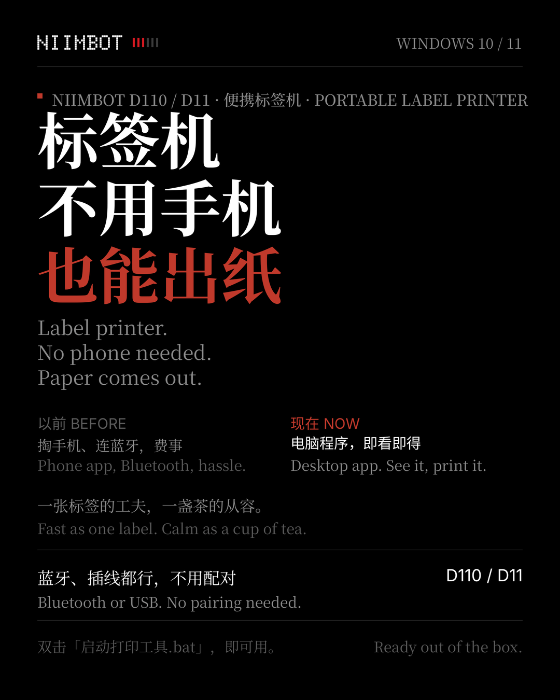
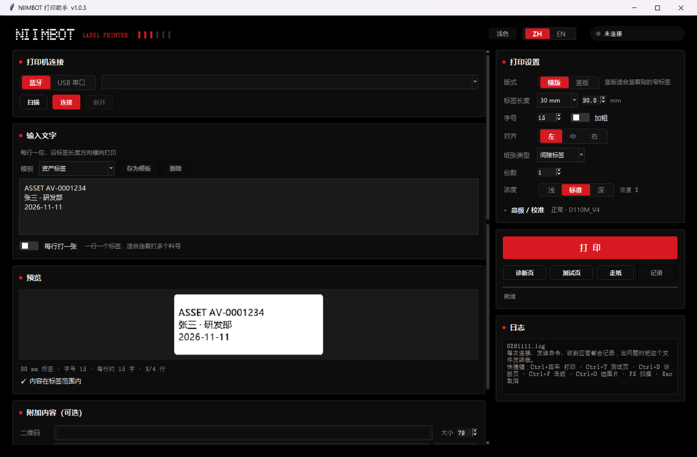
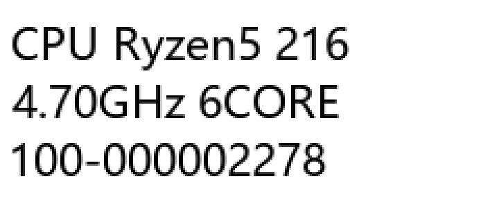
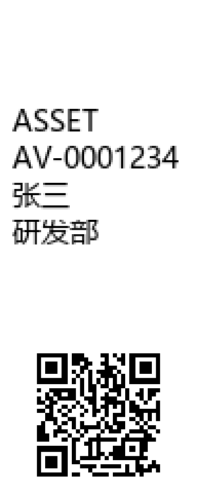

# NIIMBOT 标签打印助手

**简体中文** | [English](README.en.md)

Windows 桌面端的 NIIMBOT 便携热敏标签打印机工具，支持 **D110 / D11 / B1** 系列。
蓝牙 BLE 与 USB 串口协议均为自研实现，不依赖官方手机 App，也不需要官方 SDK。



## 直接下载（不用装 Python）

**[NIIMBOT-Printer-v1.0.5.zip](https://github.com/CelinaYun/niimbot-printer/releases/download/v1.0.5/NIIMBOT-Printer-v1.0.5.zip)** · 19.9 MB

解压后双击 `NIIMBOT打印助手.exe` 即可。Windows 10 / 11 64 位，不需要任何运行环境。
（记得解压**整个文件夹**，exe 依赖同级的 `_internal` 目录。）

## 界面



同一张 12×30 mm 的纸，两种版式：

| 横版 | 竖版 |
| :---: | :---: |
|  |  |
| 一行写到底，适合长型号 | 沿纸宽换行，附件排在下方 |

横版把纸横着用，240 点的长度够写一整行长文字；竖版把纸竖过来，同样一张纸能排 7~8 行，
二维码、条码、图片会落在文字下方。

## 为什么有这个

NIIMBOT 这类 12mm 标签机官方只提供手机 App。在电脑上打标签的流程是：
截图 → 传到手机 → 在 App 里贴图 → 打印。一天打十几张就是十几轮往返。

这个工具做的事很直接：插上 USB 或连上蓝牙，在电脑上把字排好，点打印，纸就出来了。

## 功能

| 类别 | 能力 |
| --- | --- |
| **连接** | USB 串口 / 蓝牙 BLE；自动重连上次设备；按机型 ID 自动匹配打印流程 |
| **设备发现** | 扫描时自动隐藏耳机手表等无关设备，可疑机型标 ★ 置顶 |
| **排版** | 横版（沿纸带长度写）/ 竖版（沿纸宽换行）；字号自适应；`---` `===` 画分隔线 |
| **附加内容** | 二维码、条码（Code128 / EAN-13 / UPC-A / Code39）、图片 |
| **批量** | 一行一个标签，连续出多张 |
| **省事** | 10 个内置模板 + 自定义模板、打印记录、日期占位符 `{date}` |
| **排障** | 测试页、诊断页（验打印头）、走纸、完整协议日志 |
| **界面** | 中英切换、深色 / 浅色主题、emoji 与符号 |

## 运行

需要 **Windows 10/11 64 位** 和 Python 3.10+。

```bash
# 方式一：一键脚本（首次会自动建虚拟环境并装依赖）
双击 nimbot-printer/启动打印工具.bat

# 方式二：手动
cd nimbot-printer
pip install -r requirements.txt
python main.py
```

## 关于字体

界面使用了 Nothing 的官方品牌字体（NDot 55 / NType 82 / NType 82 Mono），
这些 `.otf` **已包含在仓库内**，克隆下来就能看到完整界面。

**版权归 Nothing Technology Limited 所有。** 仅随本工具用于界面显示 ——
请勿单独提取、用于其他项目或再分发字体文件本身，详见
[`assets/fonts/NOTICE.md`](nimbot-printer/assets/fonts/NOTICE.md)。

程序对字体缺失做了降级：找不到字体会自动退回 `Consolas` / `微软雅黑`，
即使把整个字体目录删掉也照常运行。

## 打包成 exe

```bash
cd nimbot-printer
pip install pyinstaller
python -m PyInstaller --noconfirm --clean --onedir --windowed \
    --name "NIIMBOT打印助手" --add-data "assets;assets" \
    --collect-all bleak main.py
python pack_release.py     # 打成可直接分发的 zip
```

用 `--onedir` 而不是 `--onefile`：单文件每次启动都要解压，实测 45 秒；
目录模式 1.7 秒。

## 目录结构

```
nimbot-printer/          仓库根
├── README.md
└── nimbot-printer/      程序源码
    ├── main.py          入口（含单实例互斥锁）
    ├── gui.py           界面编排
    ├── fluent.py        自绘控件与主题
    ├── render.py        标签排版（横版 / 竖版）
    ├── i18n.py          中英文案
    ├── fonts.py         加载本地字体
    ├── settings.py      配置读写
    ├── paths.py         数据目录
    ├── version.py       版本号
    ├── niimbot/         协议实现
    │   ├── transport.py   串口 / BLE
    │   ├── packet.py      封包格式
    │   ├── encoder.py     位图编码
    │   ├── client.py      握手与打印流程
    │   └── trace.py       协议日志
    ├── assets/fonts/    字体存放位置（仓库内不含字体文件）
    └── 使用说明.md      详细使用与故障排查
```

## 已知限制

- 仅支持 Windows
- 热敏打印机只有黑白两色：emoji 会渲染成单色轮廓，彩色与组合 emoji（👨‍👩‍👧 🇨🇳）打不出来
- 12mm 纸宽很窄，竖版每行约 4~5 个字，超长会自动缩字号
- 部分纸卷不带 RFID，标签长度需手动与实物核对

## 说明

个人自用工具，协议实现参考了 [niimbluelib](https://github.com/AndBondStyle/niimbluelib) 的封包定义，
按实际设备行为做了适配。没有完整的自动化测试覆盖，遇到问题欢迎提 Issue 附上协议日志
（`%LOCALAPPDATA%\Niimbot打印助手\打印记录-日期.log`）。
